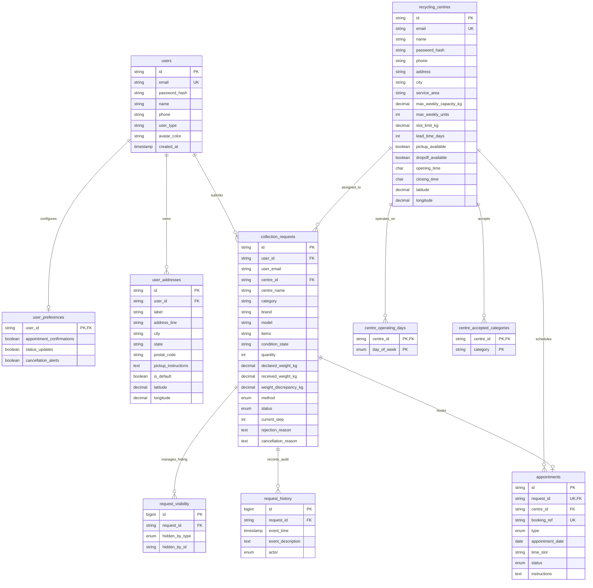

# EcoCycle — Relational MySQL Database Schema Specification

This document provides a comprehensive technical reference for the normalized MySQL 8.0 schema designed for the EcoCycle E-Waste Management & Recycling Optimization Platform.

The schema is directly derived from the operational logic, business rules, and state machines established in `storageService.js`, `AuthContext.jsx`, `CentreAuthContext.jsx`, customer request pages, and centre operational consoles.

---

## 1. Entity-Relationship Overview

---

## 2. Table Specifications

### 2.1. `users` (Customer Accounts)
Stores customer profiles and authentication credentials.

| Column | Type | Nullable | Key / Constraint | Description |
|---|---|---|---|---|
| `id` | `VARCHAR(64)` | No | `PRIMARY KEY` | Unique customer ID (`usr_...`) |
| `name` | `VARCHAR(255)` | No | | Full customer name |
| `email` | `VARCHAR(255)` | No | `UNIQUE`, `INDEX` | Login email (lowercase, normalized) |
| `password_hash` | `VARCHAR(255)` | No | | Bcrypt/Argon2 password hash (>= 60 chars) |
| `phone` | `VARCHAR(50)` | Yes | | Contact phone number |
| `user_type` | `VARCHAR(50)` | No | Default: `'Individual Resident'` | Account role / classification |
| `avatar_color` | `VARCHAR(50)` | Yes | Default: `'bg-[#FF7028]'` | UI avatar color token |
| `created_at` | `TIMESTAMP` | No | Default: `CURRENT_TIMESTAMP` | Account creation timestamp |
| `updated_at` | `TIMESTAMP` | No | Auto-updating | Last modification timestamp |
| `password_updated_at`| `TIMESTAMP` | Yes | | Last password change timestamp |

---

### 2.2. `user_preferences` (Notification Settings)
One-to-one preference extension for each registered customer.

| Column | Type | Nullable | Key / Constraint | Description |
|---|---|---|---|---|
| `user_id` | `VARCHAR(64)` | No | `PRIMARY KEY`, `FK -> users(id)` | Cascades on user deletion |
| `appointment_confirmations` | `BOOLEAN` | No | Default: `TRUE` | Email/SMS appointment alerts |
| `status_updates` | `BOOLEAN` | No | Default: `TRUE` | Lifecycle progression alerts |
| `cancellation_alerts` | `BOOLEAN` | No | Default: `TRUE` | Cancellation alerts |
| `updated_at` | `TIMESTAMP` | No | Auto-updating | Timestamp |

---

### 2.3. `user_addresses` (Customer Saved Address Book)
Customer address book supporting default selection, pickup notes, and Geoapify coordinates.

| Column | Type | Nullable | Key / Constraint | Description |
|---|---|---|---|---|
| `id` | `VARCHAR(64)` | No | `PRIMARY KEY` | Unique address ID (`ADDR-...`) |
| `user_id` | `VARCHAR(64)` | No | `FK -> users(id)`, `INDEX` | Cascades on user deletion |
| `label` | `VARCHAR(100)` | No | Default: `'Home'` | User label (Home, Work, Office) |
| `address_line` | `VARCHAR(255)` | No | | Street address |
| `city` | `VARCHAR(100)` | No | | City name |
| `state` | `VARCHAR(100)` | Yes | | State/Province |
| `postal_code` | `VARCHAR(30)` | Yes | | Postal or PIN code |
| `pickup_instructions` | `TEXT` | Yes | | Gate code, landmarks, special notes |
| `is_default` | `BOOLEAN` | No | Default: `FALSE`, `INDEX` | Default pickup destination |
| `latitude` | `DECIMAL(10, 8)` | Yes | `INDEX` | Verified latitude (-90 to +90) |
| `longitude` | `DECIMAL(11, 8)` | Yes | `INDEX` | Verified longitude (-180 to +180) |
| `created_at` | `TIMESTAMP` | No | Default: `CURRENT_TIMESTAMP` | Timestamp |
| `updated_at` | `TIMESTAMP` | No | Auto-updating | Timestamp |

---

### 2.4. `recycling_centres` (Partner Facilities)
Operating recycling facilities, throughput limits, and capability configurations.

| Column | Type | Nullable | Key / Constraint | Description |
|---|---|---|---|---|
| `id` | `VARCHAR(64)` | No | `PRIMARY KEY` | Unique centre ID (`CTR-...`) |
| `name` | `VARCHAR(255)` | No | | Facility name |
| `email` | `VARCHAR(255)` | No | `UNIQUE`, `INDEX` | Official contact & login email |
| `password_hash` | `VARCHAR(255)` | No | | Secure facility staff password hash |
| `phone` | `VARCHAR(50)` | No | | Dispatch phone |
| `address` | `VARCHAR(255)` | No | | Physical depot location |
| `city` | `VARCHAR(100)` | No | `INDEX` | Municipal service hub |
| `service_area` | `VARCHAR(255)` | No | | Service coverage boundary |
| `capabilities` | `TEXT` | Yes | | Processing methods & certifications |
| `max_weekly_capacity_kg` | `DECIMAL(10, 2)` | No | Default: `3000.00` | Weekly mass limit |
| `max_weekly_units` | `INT` | No | Default: `800` | Weekly piece count quota |
| `slot_limit_kg` | `DECIMAL(10, 2)` | No | Default: `250.00` | Max load per 2-hour window |
| `lead_time_days` | `INT` | No | Default: `2` | Advance notice required in working days |
| `pickup_available` | `BOOLEAN` | No | Default: `TRUE` | Doorstep courier service supported |
| `dropoff_available` | `BOOLEAN` | No | Default: `TRUE` | Depot drop-off supported |
| `opening_time` | `CHAR(5)` | No | Default: `'09:00'` | 24h format (`HH:mm`) |
| `closing_time` | `CHAR(5)` | No | Default: `'17:00'` | 24h format (`HH:mm`) |
| `operating_days_summary` | `VARCHAR(255)`| Yes | Default: `'Monday to Friday'` | Display summary |
| `operating_hours_summary`| `VARCHAR(255)`| Yes | Default: `'09:00 AM – 05:00 PM'`| Display summary |
| `latitude` | `DECIMAL(10, 8)` | Yes | `INDEX` | Depot latitude |
| `longitude` | `DECIMAL(11, 8)` | Yes | `INDEX` | Depot longitude |
| `staff_name` | `VARCHAR(255)` | Yes | | Operations manager name |
| `staff_role` | `VARCHAR(100)` | Yes | Default: `'Operations Lead'` | Staff title |
| `created_at` | `TIMESTAMP` | No | Default: `CURRENT_TIMESTAMP` | Timestamp |
| `updated_at` | `TIMESTAMP` | No | Auto-updating | Timestamp |
| `password_updated_at` | `TIMESTAMP` | Yes | | Last password change |

---

### 2.5. `centre_operating_days` & `centre_accepted_categories`
Normalized relational child tables representing facility schedules and allowed e-waste streams.

- **`centre_operating_days`**:
  - `(centre_id, day_of_week)` Composite Primary Key.
  - `day_of_week`: `ENUM('Mon', 'Tue', 'Wed', 'Thu', 'Fri', 'Sat', 'Sun')`.
  - Cascades on centre deletion.
- **`centre_accepted_categories`**:
  - `(centre_id, category)` Composite Primary Key.
  - `category`: Matches `CATEGORY_MAP` values (`Computers & Laptops`, `Smartphones & Tablets`, `Batteries & Power Units`, `Displays & Monitors`, `Home & Office Appliances`, `Servers & Telecom Infrastructure`).
  - Cascades on centre deletion.

---

### 2.6. `collection_requests` (Master Declarations)
The central operational entity representing all customer disposal declarations.

| Column | Type | Nullable | Key / Constraint | Description |
|---|---|---|---|---|
| `id` | `VARCHAR(64)` | No | `PRIMARY KEY` | Tracking reference (`EW-XXXXXX`) |
| `user_id` | `VARCHAR(64)` | Yes | `FK -> users(id)` | Customer account ID (SET NULL on delete) |
| `user_email` | `VARCHAR(255)` | No | `INDEX` | Normalized customer email |
| `customer_name` | `VARCHAR(255)` | No | | Customer contact name |
| `customer_phone` | `VARCHAR(50)` | Yes | | Customer phone |
| `centre_id` | `VARCHAR(64)` | Yes | `FK -> recycling_centres(id)`, `INDEX` | Assigned facility (SET NULL on close) |
| `centre_name` | `VARCHAR(255)` | No | | Preserved facility name |
| `category` | `VARCHAR(50)` | No | `INDEX` | `computing`, `mobile`, `battery`, etc. |
| `brand` | `VARCHAR(100)` | No | | Hardware brand (Dell, Apple, HP) |
| `model` | `VARCHAR(100)` | No | | Model name (Latitude, iPhone 12) |
| `items` | `VARCHAR(255)` | No | | Summary declaration string |
| `condition_state` | `VARCHAR(50)` | No | Default: `'working'` | `working`, `repairable`, `scrap`, `hazardous` |
| `quantity` | `INT` | No | Default: `1` | Piece count (1 to 1,000) |
| `declared_weight_kg` | `DECIMAL(10, 2)`| No | | Customer weight (0.01 to 5,000.00 kg) |
| `received_weight_kg` | `DECIMAL(10, 2)`| Yes | | Facility scale verification |
| `weight_discrepancy_kg`| `DECIMAL(10, 2)`| Yes | | Discrepancy metric for R analytics |
| `method` | `ENUM('pickup', 'dropoff')`| No | Default: `'dropoff'`, `INDEX` | Intake channel |
| `channel` | `VARCHAR(50)` | No | | `'Doorstep Pickup'` or `'Center Drop-off'` |
| `pickup_address` | `TEXT` | Yes | | Complete pickup address |
| `dropoff_facility_address`| `TEXT` | Yes | | Depot street address |
| `dropoff_facility_city` | `VARCHAR(100)`| Yes | | Depot city |
| `dropoff_facility_hours`| `VARCHAR(100)`| Yes | | Depot operating hours |
| `latitude` | `DECIMAL(10, 8)` | Yes | | Geocoded latitude |
| `longitude` | `DECIMAL(11, 8)` | Yes | | Geocoded longitude |
| `preferred_slot` | `VARCHAR(100)` | Yes | | Preferred intake time window |
| `notes` | `TEXT` | Yes | | Special handling notes |
| `status` | `ENUM(...)` | No | Default: `'Submitted'`, `INDEX` | 14 lifecycle states (see Section 3) |
| `current_step` | `INT` | No | Default: `0` | Step index for tracking steppers (-1, 0, 1, 2) |
| `rejection_reason` | `TEXT` | Yes | | Facility rejection explanation |
| `cancellation_reason`| `TEXT` | Yes | | Customer cancellation reason |
| `cancelled_at` | `TIMESTAMP` | Yes | | Cancellation timestamp |
| `created_at` | `TIMESTAMP` | No | Default: `CURRENT_TIMESTAMP`, `INDEX` | Declaration creation timestamp |
| `updated_at` | `TIMESTAMP` | No | Auto-updating | Timestamp |

---

### 2.7. `appointments` (Scheduled Slots)
One-to-one scheduling record associated with a collection request.

| Column | Type | Nullable | Key / Constraint | Description |
|---|---|---|---|---|
| `id` | `VARCHAR(64)` | No | `PRIMARY KEY` | Appointment ID |
| `request_id` | `VARCHAR(64)` | No | `UNIQUE`, `FK -> collection_requests(id)` | Cascade delete on request removal |
| `centre_id` | `VARCHAR(64)` | Yes | `FK -> recycling_centres(id)`, `INDEX` | Assigned facility |
| `booking_ref` | `VARCHAR(64)` | No | `UNIQUE` | Formal appointment booking reference (`APT-...`) |
| `type` | `ENUM('pickup', 'dropoff')`| No | Default: `'dropoff'` | Appointment mode |
| `appointment_date` | `DATE` | No | `INDEX` | Scheduled calendar date |
| `time_slot` | `VARCHAR(50)` | No | `INDEX` | Slot window (`09:00 AM – 11:00 AM`) |
| `time_window` | `VARCHAR(50)` | No | | Slot window alias |
| `status` | `ENUM(...)` | No | Default: `'proposed'`, `INDEX` | `proposed`, `confirmed`, `reschedule_requested`, `cancelled`, `completed` |
| `instructions` | `TEXT` | Yes | | Facility dispatch/drop-off directions |
| `pickup_address` | `TEXT` | Yes | | Confirmed pickup location |
| `customer_note` | `TEXT` | Yes | | Reschedule or customer note |
| `previous_appointment_date` | `DATE` | Yes | | Previous appointment date before rescheduling |
| `previous_time_slot` | `VARCHAR(50)` | Yes | | Previous slot before rescheduling |
| `booked_by` | `VARCHAR(255)` | Yes | | Staff member / system entity |
| `booked_at` | `TIMESTAMP` | Yes | | Booking confirmation timestamp |
| `proposed_by` | `VARCHAR(255)` | Yes | | Staff member proposing schedule |
| `proposed_at` | `TIMESTAMP` | Yes | | Proposal timestamp |
| `rescheduled_by` | `VARCHAR(255)` | Yes | | Staff member rescheduling |
| `rescheduled_at` | `TIMESTAMP` | Yes | | Reschedule timestamp |
| `created_at` | `TIMESTAMP` | No | Default: `CURRENT_TIMESTAMP` | Creation timestamp |
| `updated_at` | `TIMESTAMP` | No | Auto-updating | Timestamp |

---

### 2.8. `request_history` (Audit Trail)
Immutable chronological log of all transitions, actor interactions, and notes.

| Column | Type | Nullable | Key / Constraint | Description |
|---|---|---|---|---|
| `id` | `BIGINT` | No | `AUTO_INCREMENT`, `PRIMARY KEY` | Sequence ID |
| `request_id` | `VARCHAR(64)` | No | `FK -> collection_requests(id)`, `INDEX` | Target declaration ID |
| `event_time` | `TIMESTAMP` | No | Default: `CURRENT_TIMESTAMP`, `INDEX` | Machine timestamp |
| `event_time_formatted`| `VARCHAR(100)`| Yes | | UI human-readable string |
| `event_description` | `TEXT` | No | | Event details |
| `actor` | `ENUM('Customer', 'Centre Staff', 'System')` | No | | Acting principal |

---

### 2.9. `request_visibility` (History Hiding / Archiving)
Implements independent customer and centre history archive toggles. When an eligible terminal record is hidden, an entry is inserted here; the master declaration remains untouched.

| Column | Type | Nullable | Key / Constraint | Description |
|---|---|---|---|---|
| `id` | `BIGINT` | No | `AUTO_INCREMENT`, `PRIMARY KEY` | Sequence ID |
| `request_id` | `VARCHAR(64)` | No | `FK -> collection_requests(id)` | Target declaration ID |
| `hidden_by_type` | `ENUM('customer', 'centre')` | No | | Party hiding the record |
| `hidden_by_id` | `VARCHAR(255)` | No | `INDEX` | User email or Centre ID |
| `created_at` | `TIMESTAMP` | No | Default: `CURRENT_TIMESTAMP` | Timestamp |
| Constraint | `UNIQUE KEY` | | `(request_id, hidden_by_type, hidden_by_id)` | Prevents duplicate hide entries |

---

## 3. Request Status Lifecycle & Stepper Mappings

EcoCycle defines 14 granular statuses spanning uncompleted active workflows and terminal resolved states:

| Status | Category | Stepper Index | Can Hide from History? | Can Cancel? |
|---|---|:---:|:---:|:---:|
| `Submitted` | Unresolved / Active | 0 | No | Yes |
| `Accepted` | Unresolved / Active | 0 | No | Yes |
| `Schedule Proposed` | Unresolved / Active | 0 | No | Yes |
| `Scheduled` | Unresolved / Active | 1 | No | Yes |
| `Confirmed` | Unresolved / Active | 1 | No | Yes |
| `In Transit` | Unresolved / Active | 1 | No | No (Dispatched) |
| `Reschedule Requested` | Unresolved / Active | 1 | No | Yes |
| `Received` | Resolved / Terminal | 2 | Yes | No |
| `Drop-off Completed` | Resolved / Terminal | 2 | Yes | No |
| `Processing` | Resolved / Terminal | 2 | Yes | No |
| `Completed` | Resolved / Terminal | 2 | Yes | No |
| `Recycled` | Resolved / Terminal | 2 | Yes | No |
| `Rejected` | Resolved / Terminal | -1 | Yes | No |
| `Cancelled` | Resolved / Terminal | -1 | Yes | No |

---

## 4. Deletion Protection Rules

As verified in `checkCustomerDeletionEligibility` and `checkCentreDeletionEligibility`:
1. **Customer Account Deletion**:
   - Strictly rejected if any request exists in an unresolved state (`Submitted`, `Accepted`, `Schedule Proposed`, `Scheduled`, `Confirmed`, `In Transit`, `Reschedule Requested`).
   - When eligible, user row is deleted; foreign keys on `collection_requests.user_id` set to `NULL`, retaining customer email string for auditability, and removing user preferences and addresses via `ON DELETE CASCADE`.
2. **Centre Account Deletion**:
   - Strictly rejected if any active declarations are assigned to the facility.
   - When eligible, centre row is removed; associated request rows update `centre_id = NULL` and set `centre_name = '[Facility Name] (Closed / Deregistered)'`.

---

## 5. Capacity Rules & Slot Calculations

Capacity is computed atomically across four tiers:
1. **Weekly Mass Cap**: `max_weekly_capacity_kg` (default: 3,000 kg).
2. **Weekly Unit Cap**: `max_weekly_units` (default: 800 items).
3. **Daily Mass Cap**: `ceil(max_weekly_capacity_kg / active_days_count)`.
4. **Slot Cap**: `slot_limit_kg` (default: 250 kg) across the 4 standard slots:
   - `09:00 AM – 11:00 AM`
   - `11:00 AM – 01:00 PM`
   - `02:00 PM – 04:00 PM`
   - `04:00 PM – 06:00 PM`
5. **Operating Day Lead Time**: Advance notice must be calculated across **facility operating days** (skipping closed days), not calendar days.
